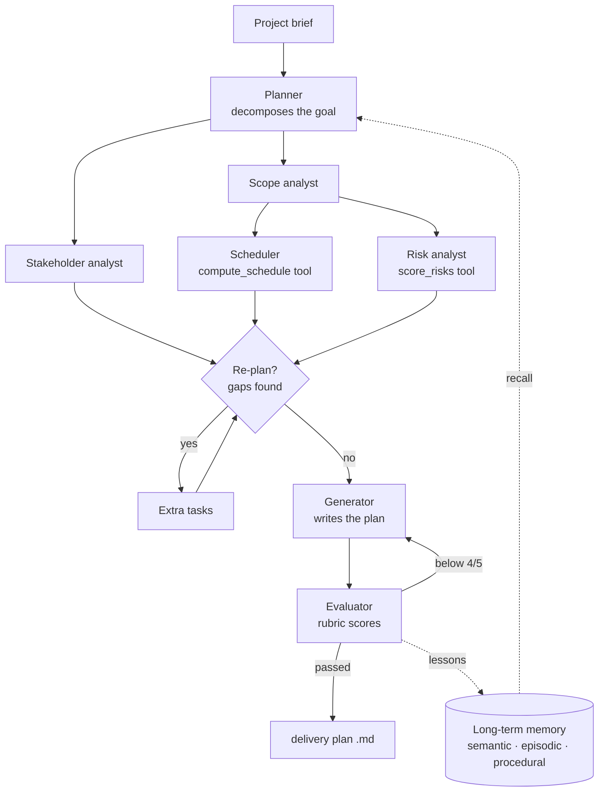

# Delivery Agent 🤖📋

A production-style AI agent that turns an IT project brief into a **reviewed delivery plan**
(scope & WBS, critical-path schedule, risk register, stakeholders & RACI, governance), built
with the Claude API.

It follows the idea that separates demo agents from production agents: a real agent is not one
prompt in a loop, it **combines the five core agentic design patterns**.

| # | Pattern | What it means | Where it lives |
|---|---|---|---|
| 1 | **Tool use / function calling** | The model decides when to call external functions and uses the results | [`src/tools.js`](src/tools.js): critical-path scheduler, risk scoring, file reader, memory tools, optional web search |
| 2 | **Reflection** | A generator produces output, an evaluator scores it against a rubric and gives feedback, and the loop repeats until it passes | [`src/reflection.js`](src/reflection.js) |
| 3 | **Plan & execute** | Break a complex goal into ordered subtasks, execute them, re-plan if there are gaps | [`src/planner.js`](src/planner.js) |
| 4 | **Orchestrator / workers** | A lead agent decomposes the problem and delegates to specialised workers, each with a narrow role and its own context window | [`src/workers.js`](src/workers.js), [`src/agent.js`](src/agent.js) |
| 5 | **Memory & context management** | Persist and retrieve the right state across steps and sessions | [`src/memory.js`](src/memory.js) (semantic, episodic and procedural memory) + per-run working memory in `src/agent.js` |

## How it works



1. **Recall.** Relevant memories (facts about your organisation, lessons from earlier reviews,
   summaries of past projects) are retrieved for the brief.
2. **Plan.** The orchestrator splits the goal into 3-7 subtasks, each assigned to a worker,
   with dependencies. Output is schema-validated (structured outputs).
3. **Execute.** Tasks run in *waves*: everything whose dependencies are done runs in parallel.
   Each worker gets a fresh context with only the brief, its subtask and the outputs it depends
   on. That is context engineering: it keeps workers focused and avoids context pollution.
   Workers call tools for anything deterministic: the scheduler never does date arithmetic
   itself, it calls `compute_schedule` (critical path over working days).
4. **Re-plan.** The orchestrator checks the results for gaps and can add up to 3 more tasks.
5. **Reflect.** A generator writes the plan; an evaluator scores it on 5 criteria (grounded,
   complete, consistent, actionable, concise). Anything below 4/5 goes back with feedback, for
   up to 3 rounds.
6. **Remember.** The episode and the evaluator's reusable lessons are saved, so the next plan
   starts out better.

## Setup

Requires Node.js 20+ and an [Anthropic API key](https://platform.claude.com/).

```bash
cd delivery-agent
npm install
export ANTHROPIC_API_KEY=sk-ant-...
```

## Usage

```bash
node src/cli.js examples/crm-migration.md
```

The plan is written to `output/<project>.md`, with an appendix showing the evaluator's scores.
Progress is logged as it goes (illustrative; task names and scores vary by brief):

```
Planning...
  goal: Migrate the legacy CRM to the cloud before the licence expires
  T1 [scope_analyst] Work breakdown and acceptance criteria
  T2 [stakeholder_analyst] Stakeholder map, RACI and governance
  T3 [scheduler] Schedule around the quarter-end freeze <- T1
  T4 [risk_analyst] Risk register for data migration and cutover <- T1
Executing...
  wave: T1 (scope_analyst), T2 (stakeholder_analyst)
  wave: T3 (scheduler), T4 (risk_analyst)
Writing and reviewing the delivery plan...
  round 1: average 3.8/5 - revising
  round 2: average 4.4/5 - passed
```

Options:

| Flag | Default | |
|---|---|---|
| `--web` | off | lets the risk analyst search the web (vendor issues, regulations) |
| `--out <dir>` | `output` | where plans are written |
| `--memory <file>` | `data/memory.json` | long-term memory; delete it to start fresh |

Environment variables: `AGENT_MODEL` (default `claude-opus-5-5`) and `AGENT_WORKER_MODEL`
(defaults to `AGENT_MODEL`). Set the worker model to a cheaper model to cut cost.

Workers can read other files next to the brief (requirements, notes), so put supporting
documents in the same folder.

## Cost

One run makes roughly 10-20 model calls: planning, 4-7 workers (each may loop through a few
tool calls), a re-plan check, then 1-3 generate/evaluate rounds. Cost scales with the length of
the brief and the number of revision rounds; check usage in the Claude Console after your first
runs, and set `AGENT_WORKER_MODEL` to a cheaper model if you want to cut it.

## Tests

```bash
npm test
```

- **Unit tests** cover the deterministic parts: scheduling, risk scoring, path safety, plan
  validation and memory.
- **End-to-end test** runs the whole agent against a local mock of the Messages API, so you
  need no API key. It checks waves, a real tool call, context isolation, the reflection loop
  and memory persistence.

## Adapting it

The patterns are generic; the project-management domain lives in a few places:

- add or change specialists in `WORKERS` (`src/workers.js`);
- add tools in `createTools` (`src/tools.js`) and list them on a worker;
- change the review rubric in `RUBRIC` (`src/reflection.js`).
