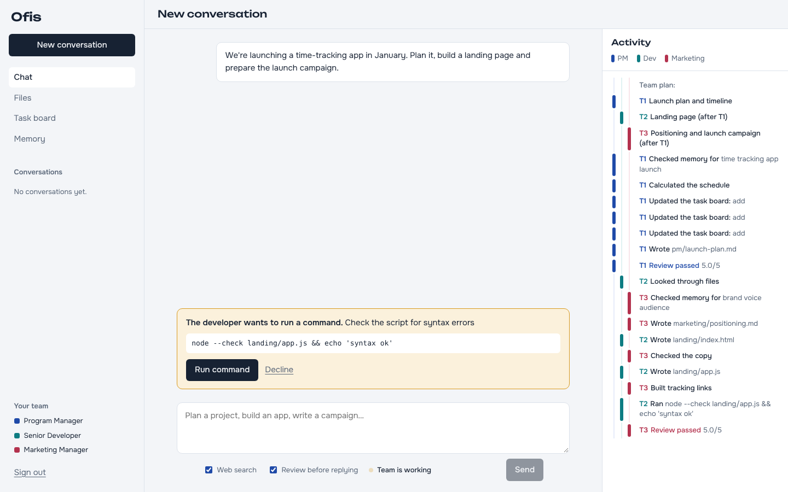
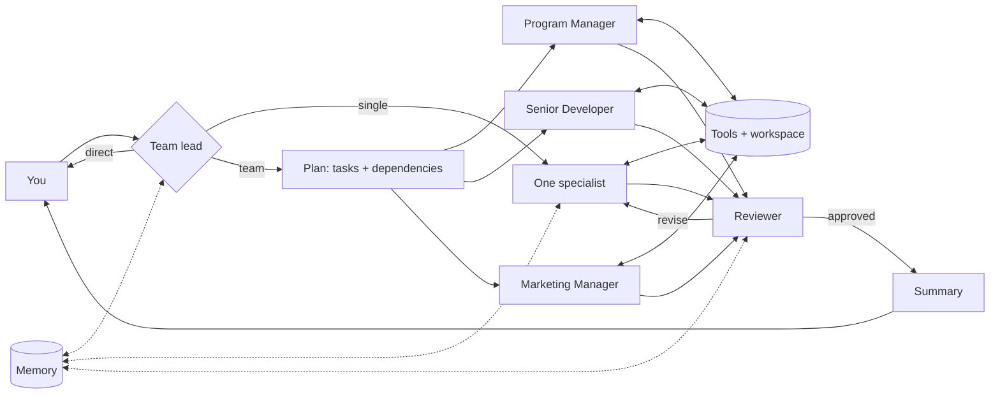
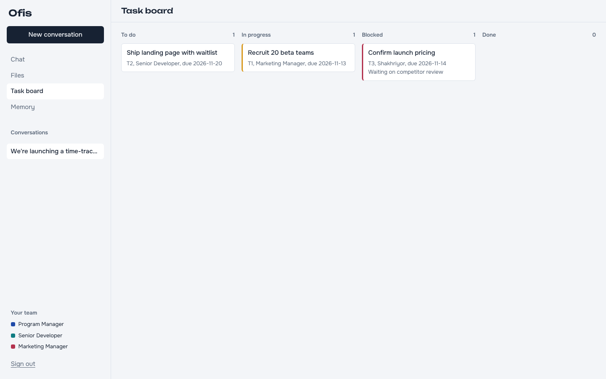

# Ofis: your AI team 🧑‍💼👩‍💻📣

A private web platform (and terminal app) for an **AI team**: a Program Manager, a Senior
Developer and a Marketing Manager, coordinated by a team lead. Ask for anything (a project
plan, a working app, a launch campaign, or all three) and the right specialists pick it up,
use real tools, review each other's work and remember what they learn about your business.


*Screenshot with sample data: the activity panel on the right shows who is doing what, one
colored lane per specialist; the developer is waiting for approval to run a command.*

## The team

| Specialist | Does | Tools |
|---|---|---|
| **Program Manager** | project plans, roadmaps, WBS, schedules and critical path, risk registers, RACI, status reports, PRDs, task tracking | critical-path scheduler, risk scoring, persistent task board, files, web search |
| **Senior Developer** | builds what you ask: apps, APIs, scripts, websites; runs and tests the code, debugs, reviews | read/write/edit files, shell commands (with your approval), web search |
| **Marketing Manager** | positioning, go-to-market, campaigns, blog/landing/email/social/ad copy, SEO, competitor research, content calendars | content & SEO checker, UTM link builder, files, web search |
| **Team lead** (router) | decides who should handle each message, splits cross-discipline requests into a plan, and summarises the result | - |

Everything the team produces is saved in the **workspace** folder: code in a folder per project,
PM documents in `pm/`, marketing material in `marketing/`.

## What it can and can't do

**Can:** write, run and test real code in the workspace; produce plans, schedules and
documents grounded in tool calculations; research the web and write channel-ready marketing
copy; remember facts about your business across sessions.

**Can't (yet):** act on outside systems. It doesn't deploy, publish posts, send emails, spend ad
budget or update Jira/GitHub. Those need connectors and credentials (see *Extending*), and any
outward-facing action should stay behind your approval. Treat its output like a strong
teammate's first version: review it before it goes to customers or production.

## How it works: the five agentic design patterns

| Pattern | Where |
|---|---|
| **Tool use**: the model calls real functions and uses the results | `src/tools/`: scheduler, risk scoring, task board, files, shell, SEO checker, UTM builder, memory, web search |
| **Reflection**: a reviewer scores deliverables against a per-role rubric; the specialist revises until it passes (up to 2 revisions) | `Team.runSpecialist` / `reviewWork` in `src/team.js`, rubrics in `src/agents.js` |
| **Plan & execute**: cross-discipline requests are split into tasks with dependencies and run in waves | `Team.runTeam` in `src/team.js` |
| **Orchestrator / workers**: a team lead routes work to specialists with narrow roles, their own tools and isolated context | `src/team.js`, `src/agents.js` |
| **Memory & context management**: recent conversation, long-term memory (facts, past requests, reviewer lessons) and per-task context isolation | `src/memory.js`, `Team.contextBlock` |



## Run it on your computer

Requires Node.js 20+ and an [Anthropic API key](https://platform.claude.com/) (billed per use,
separately from a Claude.ai subscription).

```bash
cd universal-agent
npm install
cp .env.example .env      # then put your ANTHROPIC_API_KEY and APP_PASSWORD in .env
npm start
```

Open http://localhost:3000 and sign in with your password. Both `npm start` and `npm run chat`
read `.env` automatically (it is git-ignored, so your key never reaches GitHub); variables set in
your shell take precedence.

### What's in the web app

- **Chat**: talk to the team. Conversations are saved; the team keeps context within each one.
  Toggle web search and review per message.
- **Activity**: a live view of each step, in a lane per specialist, so you can see parallel
  work and reviews as they happen. Each reply keeps its steps under *Show steps*.
- **Approvals**: when the developer needs to run a command, you get a card with the command
  and the reason. Nothing runs until you click *Run command*.
- **Files**: browse, read and download everything the team created in the workspace.
- **Task board**: the Program Manager's board (to do, in progress, blocked, done).
- **Memory**: what the team knows about your business, lessons from reviews, past requests.



### Prefer the terminal?

```bash
npm run chat                                    # interactive chat
npm run chat -- "Write a PRD for a feedback portal"   # one request
```

| Option | Default | |
|---|---|---|
| `--workspace <dir>` | `workspace` | where code and documents are saved |
| `--memory <file>` | `data/memory.json` | long-term memory (delete to reset) |
| `--yes` | off | run shell commands without asking (see Safety) |
| `--no-web` | web on | disable web search |
| `--no-review` | review on | skip the reviewer loop: faster and cheaper, lower quality |

The web app and the terminal share the same workspace and memory when run from the same folder.

## Put it online

Run it on a server so you can use it from your phone or any browser. The included Docker setup
keeps the developer agent's commands inside a container.

**On a VPS (Ubuntu/Debian), one command:**

```bash
curl -fsSL https://raw.githubusercontent.com/Shakhti17/Shakhti17/main/universal-agent/deploy/install.sh | sudo bash
```

It adds swap on small servers, installs Docker, downloads the code to `/opt/ofis`, asks for
your Anthropic API key, sign-in password and domain, then starts Ofis behind Caddy with
automatic HTTPS. No domain? Press Enter to use `<your-ip-with-dashes>.sslip.io`, a free name
that points at your server. Run the same command again to update; your settings,
conversations, memory and files are kept. (Not sure the server is big enough? Run
`deploy/check-vps.sh` first; it changes nothing.)

Doing it by hand instead: copy `.env.example` to `.env`, fill it in (with `TRUST_PROXY=1` and
`DOMAIN`), then run `docker compose --profile https up -d --build`.

**On Render or Railway:** create a service from this repository with `universal-agent` as the
root directory and the Dockerfile as the build. Add the environment variables from
`.env.example` (with `TRUST_PROXY=1`), and attach persistent disks at `/data` and `/workspace`
so conversations, memory and files survive redeploys.

| Variable | |
|---|---|
| `ANTHROPIC_API_KEY` | required, unless you use identity federation (below) |
| `APP_PASSWORD` | required, at least 8 characters; use a long passphrase |
| `SESSION_SECRET` | keeps you signed in across restarts (`openssl rand -hex 32`) |
| `TRUST_PROXY` | `1` behind an HTTPS proxy, so the session cookie is marked Secure |
| `PORT`, `HOST` | default `3000`, `127.0.0.1` (`0.0.0.0` in Docker) |
| `DATA_DIR`, `WORKSPACE_DIR` | default `./data`, `./workspace` |
| `AGENT_MODEL` | default `claude-opus-5-5` |

**No API key on Google Cloud, AWS, Azure or GitHub Actions:** these platforms can give the app
short-lived identity tokens, which the Anthropic SDK exchanges for access automatically
(identity federation). Set it up in the Claude Console, then set
`ANTHROPIC_FEDERATION_RULE_ID`, `ANTHROPIC_ORGANIZATION_ID`, `ANTHROPIC_SERVICE_ACCOUNT_ID` and
`ANTHROPIC_IDENTITY_TOKEN_FILE` instead of `ANTHROPIC_API_KEY` (an API key, if also set, takes
precedence, so remove it). Your laptop, Render, Railway and plain VPS hosts have no identity
provider, so use an API key there.

## Safety

- **One owner, one password.** Sign-in sets an HttpOnly, SameSite=Strict session cookie;
  repeated wrong passwords are locked out for 15 minutes. Always serve it over HTTPS when online.
- **Every shell command needs your approval**, in the browser or the terminal (unless you
  pass `--yes` to the CLI). Unanswered approvals are declined after 10 minutes.
- Commands run inside the workspace folder with a 2-minute timeout and never see your
  `ANTHROPIC_*` credentials. Locally they run on your machine; online, run the Docker image so
  they stay inside the container.
- File tools only read and write inside the workspace. The web app shows files as plain text
  and never renders them as pages, so code the team writes can't run in your session.
- Replies are rendered from Markdown and sanitised; the page has a strict Content Security
  Policy with no third-party scripts, fonts or trackers.
- The marketing manager drafts; it never publishes or sends anything.

## Cost

A quick question is one call. A single-specialist deliverable is typically a few to a few
dozen calls (tool loops plus the review). A full team request runs several specialists plus
reviews, so it costs more. Use `--no-review` and `--no-web` for cheaper runs, and check usage
in the Claude Console.

## Tests

```bash
npm test
```

- **Unit tests** cover the tools: path confinement, shell (exit codes, timeouts, credential
  stripping), scheduling, risk scoring, task board, SEO checker, UTM links and memory.
- **End-to-end test** runs a full team request against a local mock of the Messages API, so you
  need no API key. It checks routing, parallel waves, real file writes and commands, the review
  loop, memory and conversation context.
- **Web platform test** drives the HTTP API the same way the browser does: sign-in and lockout,
  a chat run streamed over Server-Sent Events with a command approved mid-run, saved
  conversations, file viewing and download, path safety and security headers.

## Extending

- **Add a specialist** (e.g. QA engineer, designer, data analyst, sales): add an entry to
  `AGENTS` in `src/agents.js` with a role prompt, tool groups and a rubric. The team lead picks
  it up automatically.
- **Add tools**: create them in `src/tools/` with `betaZodTool` and register a group in
  `buildTools`.
- **Connect real systems** (GitHub, Jira, Slack, social media, analytics): add tools that call
  their APIs, or use MCP servers. Keep anything that publishes, deploys or spends money behind
  an approval like `run_command`'s.
