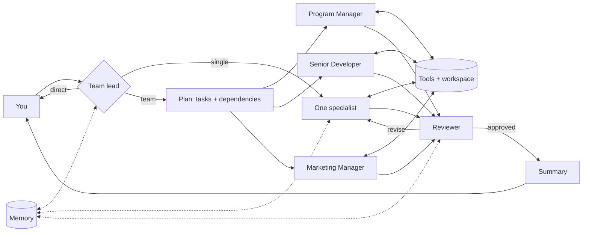

# Universal Agent 🧑‍💼👩‍💻📣

One chat interface to an **AI team**: a Program Manager, a Senior Developer and a Marketing
Manager, coordinated by a team lead. Ask for anything (a project plan, a working app, a launch
campaign, or all three) and the right specialists pick it up, use real tools, review each
other's work and remember what they learn about your business.

```
you › Build a landing page for my dental-clinic CRM and plan the launch

→ Team plan:
   T1 Program Manager: Launch plan and timeline
   T2 Senior Developer: Landing page (after T1)
   T3 Marketing Manager: Positioning, copy and launch campaign (after T1)
   [Program Manager T1] compute_schedule
   [Program Manager T1] manage_tasks add
   [Senior Developer T2] write_file landing-page/index.html
   [Marketing Manager T3] web_search dental practice management software pricing
   [Senior Developer T2] run_command npm test
   [Senior Developer T2] review 4.5/5 - approved
→ Team lead: summarising
```
*(Illustrative output; the actual plan, tools and scores depend on the request.)*

## The team

| Specialist | Does | Tools |
|---|---|---|
| **Program Manager** | project plans, roadmaps, WBS, schedules and critical path, risk registers, RACI, status reports, PRDs, task tracking | critical-path scheduler, risk scoring, persistent task board, files, web search |
| **Senior Developer** | builds what you ask: apps, APIs, scripts, websites; runs and tests the code, debugs, reviews | read/write/edit files, shell commands (with your approval), web search |
| **Marketing Manager** | positioning, go-to-market, campaigns, blog/landing/email/social/ad copy, SEO, competitor research, content calendars | content & SEO checker, UTM link builder, files, web search |
| **Team lead** (router) | decides who should handle each message, splits cross-discipline requests into a plan, and summarises the result | - |

Everything the team produces is saved in the **workspace** folder: code in a folder per project,
PM documents in `pm/`, marketing material in `marketing/`.

## What it can and can't do

**Can:** write, run and test real code in the workspace; produce plans, schedules and
documents grounded in tool calculations; research the web and write channel-ready marketing
copy; remember facts about your business across sessions.

**Can't (yet):** act on outside systems. It doesn't deploy, publish posts, send emails, spend ad
budget or update Jira/GitHub. Those need connectors and credentials (see *Extending*), and any
outward-facing action should stay behind your approval. Treat its output like a strong
teammate's first version: review it before it goes to customers or production.

## How it works: the five agentic design patterns

| Pattern | Where |
|---|---|
| **Tool use**: the model calls real functions and uses the results | `src/tools/`: scheduler, risk scoring, task board, files, shell, SEO checker, UTM builder, memory, web search |
| **Reflection**: a reviewer scores deliverables against a per-role rubric; the specialist revises until it passes (up to 2 revisions) | `Team.runSpecialist` / `reviewWork` in `src/team.js`, rubrics in `src/agents.js` |
| **Plan & execute**: cross-discipline requests are split into tasks with dependencies and run in waves | `Team.runTeam` in `src/team.js` |
| **Orchestrator / workers**: a team lead routes work to specialists with narrow roles, their own tools and isolated context | `src/team.js`, `src/agents.js` |
| **Memory & context management**: recent conversation, long-term memory (facts, past requests, reviewer lessons) and per-task context isolation | `src/memory.js`, `Team.contextBlock` |



## Setup

Requires Node.js 20+ and an [Anthropic API key](https://platform.claude.com/).

```bash
cd universal-agent
npm install
export ANTHROPIC_API_KEY=sk-ant-...
```

## Usage

Interactive chat (the team keeps the conversation context between messages):

```bash
node src/cli.js
```

One request, then exit:

```bash
node src/cli.js "Write a PRD for a customer feedback portal"
node src/cli.js "Build a REST API for a todo app with tests"
node src/cli.js "Create a 4-week LinkedIn content calendar for our CRM launch"
node src/cli.js "We're launching a time-tracking app in January. Plan it, build an MVP and prepare the launch."
```

Tell it about your business once ("We sell a CRM for dental clinics in Uzbekistan; our stack is
Node.js and MongoDB") and the specialists save it to memory and use it from then on.

| Option | Default | |
|---|---|---|
| `--workspace <dir>` | `workspace` | where code and documents are saved |
| `--memory <file>` | `data/memory.json` | long-term memory (delete to reset) |
| `--yes` | off | run shell commands without asking (see Safety) |
| `--no-web` | web on | disable web search |
| `--no-review` | review on | skip the reviewer loop: faster and cheaper, lower quality |

`AGENT_MODEL` overrides the model (default `claude-opus-5-5`).

## Safety

- File tools only read and write inside the workspace.
- **Every shell command asks for your approval** with the reason, unless you pass `--yes`.
  Commands run on your machine (not in a sandbox), inside the workspace folder, with a 2-minute
  timeout, and never see your `ANTHROPIC_*` credentials. Only use `--yes` inside a container or VM.
- The marketing manager drafts; it never publishes or sends anything.

## Cost

A quick question is one call. A single-specialist deliverable is typically a few to a few
dozen calls (tool loops plus the review). A full team request runs several specialists plus
reviews, so it costs more. Use `--no-review` and `--no-web` for cheaper runs, and check usage
in the Claude Console.

## Tests

```bash
npm test
```

- **Unit tests** cover the tools: path confinement, shell (exit codes, timeouts, credential
  stripping), scheduling, risk scoring, task board, SEO checker, UTM links and memory.
- **End-to-end test** runs a full team request against a local mock of the Messages API, so you
  need no API key. It checks routing, parallel waves, real file writes and commands, the review
  loop, memory and conversation context.

## Extending

- **Add a specialist** (e.g. QA engineer, designer, data analyst, sales): add an entry to
  `AGENTS` in `src/agents.js` with a role prompt, tool groups and a rubric. The team lead picks
  it up automatically.
- **Add tools**: create them in `src/tools/` with `betaZodTool` and register a group in
  `buildTools`.
- **Connect real systems** (GitHub, Jira, Slack, social media, analytics): add tools that call
  their APIs, or use MCP servers. Keep anything that publishes, deploys or spends money behind
  an approval like `run_command`'s.
